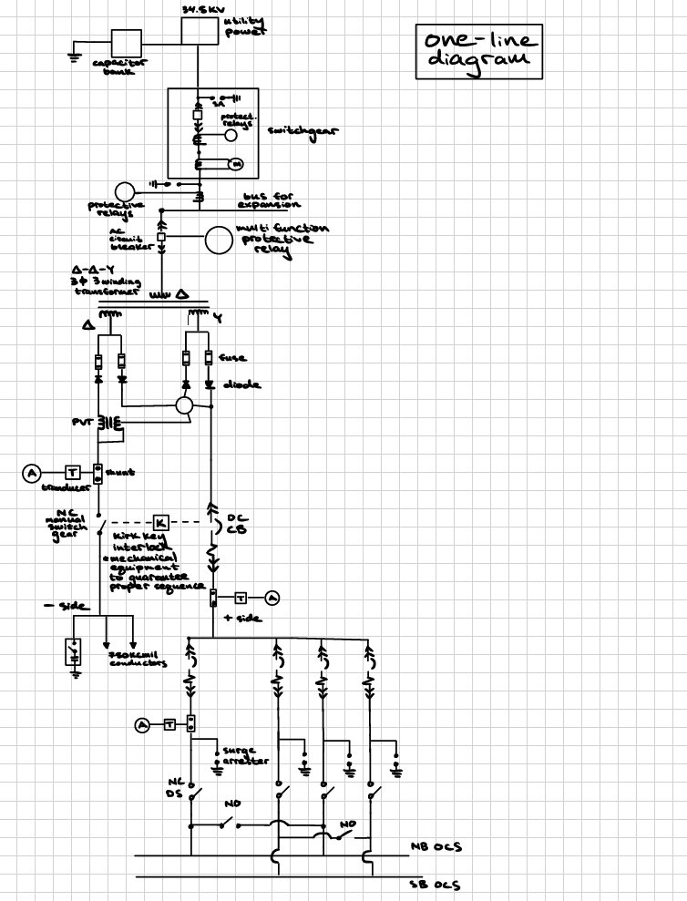
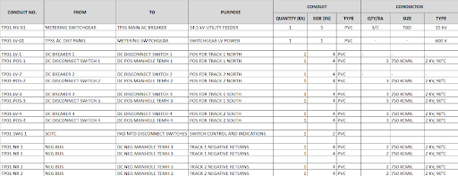
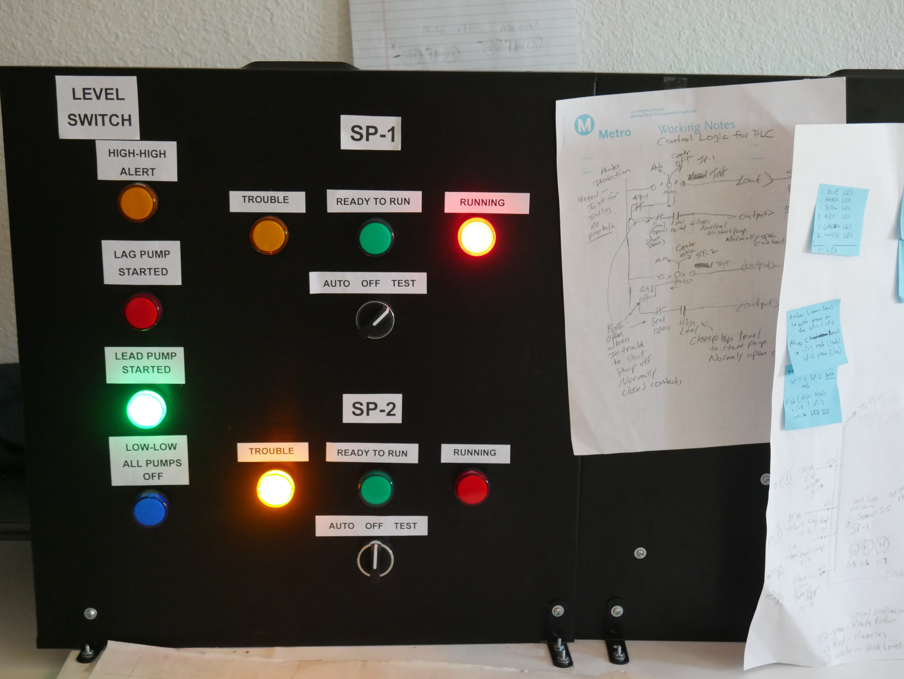
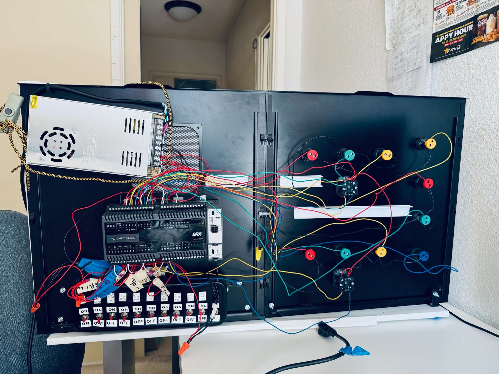
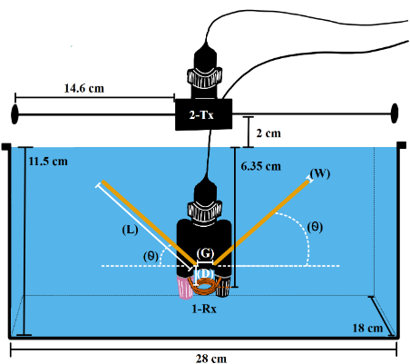
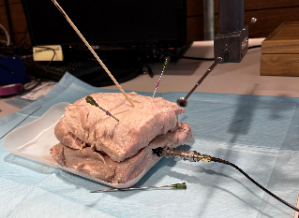
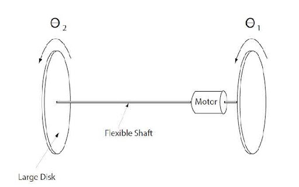
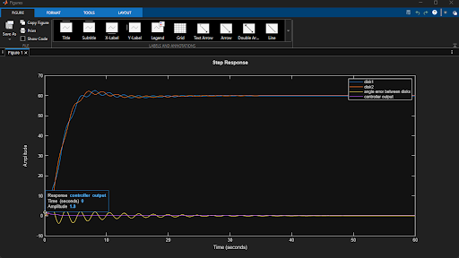

<!--Section 1: Introduce yourself-->
## ABOUT ME
Engineer 1 at PacifiCorp | Substation Engineering Standards

I am an Engineer 1 at PacifiCorp in Substation Engineering Standards, with a background in Electrical Engineering from the University of Utah. I graduated with a 3.85 GPA and an emphasis in Power Engineering. My technical interests include power systems, protection and control systems, and electrical design.

My engineering project experience includes traction power substation design, PLC-based control panel development, RF antenna research, and classical control system design. Through these projects, I have applied electrical system analysis, protective relaying concepts, PLC programming, troubleshooting, MATLAB modeling, and electrical design principles to develop and evaluate practical engineering solutions.

I am committed to continuing to develop my technical expertise and applying engineering principles to support the design, performance, and reliability of electrical power systems.

## ENGINEERING PROJECTS

---
**Traction Power Substation (TPSS) Design Project**

Designed a traction power substation for a 3-car light rail vehicle, including traction power distribution, transformer and rectifier sizing, protective relaying, and emergency trip systems.

**Traction power substation one-line diagram showing the overall electrical power distribution.**

**Raceway and cable schedule showing the electrical connections and cable routing throughout the system.**

<a href ="UTA Trax TPSS.pdf"> View the full project report</a>

---

**PLC-Based Control System — Dual Sump Pump Prototype**

Translated mechanical requirements into electrical controls and PLC ladder logic for a dual-pump sump system. Engineered and built a low-cost control panel prototype with PLC I/O, control wiring, switches, and status indicators.

**Front view of the control panel showing pump status, level alarms, Auto/Off/Test controls, and system indicators.**

Scenario: Tested lead/lag pump operation by starting SP-1 as the lead pump and simulating rising water to activate SP-2. A seal failure was simulated on SP-2 to verify the trouble light activated and the pump shut off.

**Back view showing the PLC, control wiring, simulated field inputs, and panel I/O connections.**

---

**RF Engineering Research – Implantable Antennas** 

As implantable medical devices become smaller with advances in battery technology, mm-scale antennas face challenges in wireless signal transmission and reception. This project investigates injectable, passive, flexible focusing antennas designed to improve RF signal coupling. We optimized antenna diameter, length, angle, tip gap, and spacing from the receiving coil and evaluated performance in saline solution and pork tissue to approximate human biological environments.

**Saline solution setup used to find optimized antenna parameters**

**Pork tissue setup used to evaluate optimized antenna**

<a href ="Implantable Antenna Power Point.pdf"> View Project Presentation</a>

---

**Classical Control Systems Design – Flexible Rotating System**

Designed a controller for a flexible two-disk system to track a 60° position command while maintaining system stability and minimizing the angle difference between the disks.
Used MATLAB to analyze the system through Bode plots and root-locus analysis, and iteratively developed PI, PD, and PID controllers to meet the system requirements. 

**Flexible two-disk system model showing the motor-driven Disk 1 and flexible Disk 2.**

**Tuned PID step response for a 60° input, showing disk responses, angle error, and controller output.**

<a href ="Controls Design Part 2.pdf"> View Technical Report </a>

---

## EDUCATION & SKILLS

### Education

**Bachelor of Science in Electrical Engineering, GPA: 3.85**  
University of Utah, Salt Lake City  
Power Engineering Emphasis | 7-Time Dean's List

---

### Technical Skills

| Category | Skills |
|---|---|
| **Power Systems** | Power system analysis, substation design, transformers, protective relaying |
| **Controls** | PLC ladder logic, PID control, MATLAB modeling and analysis |
| **Electrical Design** | AutoCAD, Revit, one-line diagrams, wiring diagrams, raceway and cable schedules |
| **Programming** | MATLAB, Python, Java |
| **Standards** | IEEE standards, NFPA 70 (NEC), NFPA 130 |

---

## CONTACT ME

📧 **Email:** [charleslanger999@gmail.com](mailto:charleslanger999@gmail.com)  
📱 **Phone:** [(747) 255-9982](tel:+17472559982)  
📍 **Location:** Salt Lake City, UT  
💼 **LinkedIn:** [Charles Langer](https://www.linkedin.com/in/charleslanger)   
📄 **Resume:** <a href ="Charles Langer Resume rev5 (5th Year).pdf"> View my Resume </a>

